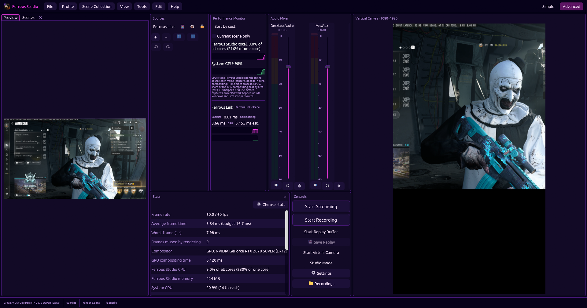
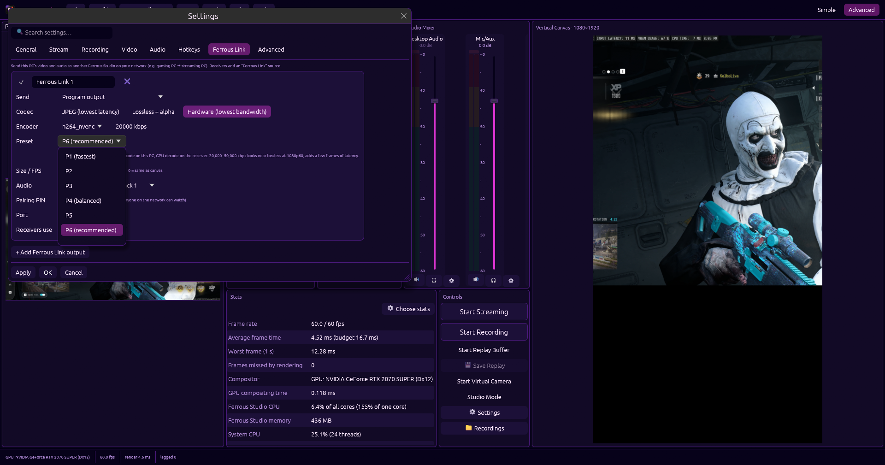
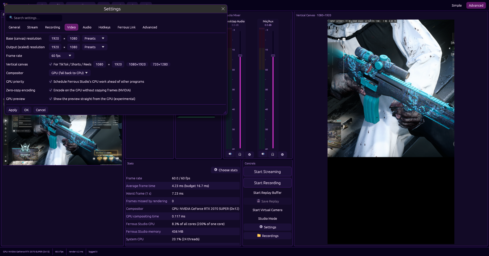
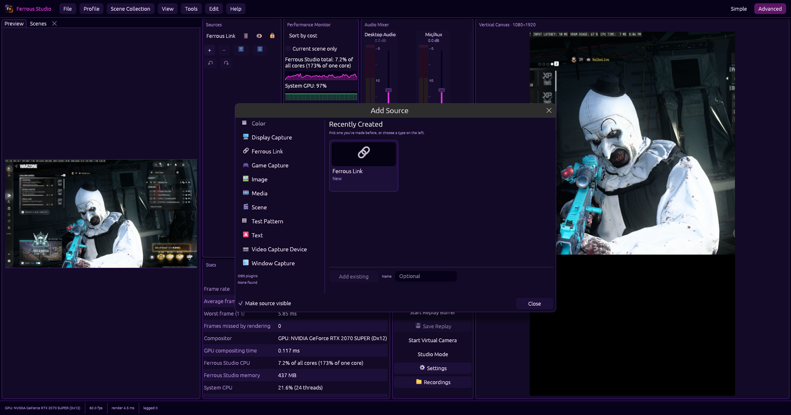
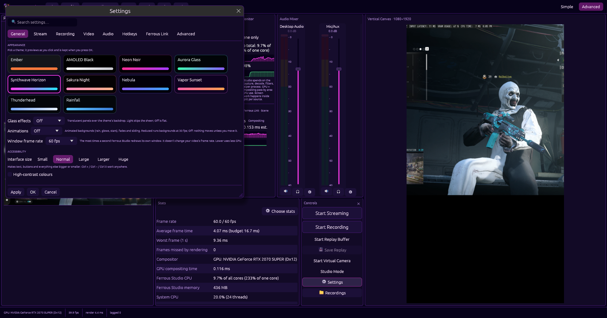

# Ferrous Studio 1.0.0

Download **FerrousStudio-1.0.0-Setup.exe** and run it (Windows 10 1809 or later, 64-bit). Everything it needs is included. Prefer no installer? Use the portable zip and run `Ferrous Studio.exe`.

Upgrading from Ferrous: your settings, profiles, scenes and plugins are copied over on first launch.

### New
- **Renamed to Ferrous Studio.** Settings, profiles, scenes and plugins are copied from `%APPDATA%\Ferrous` to `%APPDATA%\Ferrous Studio` on first launch (the old folder is left as it was). The virtual camera is now "Ferrous Studio Virtual Camera".
- **Windows installer** with everything included: FFmpeg (GPL build with every encoder), the virtual camera, the OBS plugin host, the example plugin, the C runtime built into the exe, WebView2 installed where it's missing, and an optional Windows Firewall rule for Ferrous Link. A portable zip is published alongside it.
- **Preview straight from the GPU** (Settings → Video → *GPU preview*): the compositor and the window share one GPU device, so the preview is drawn from the canvas texture with no copy back to the CPU, as OBS does.
- **Vertical-only mode**: hide the main canvas and keep just the vertical one when you only stream vertically; the main picture isn't composited while nothing uses it.
- **A monitoring button on every mixer channel**, like OBS: one click to hear a channel through your monitoring device, one click to stop.
- **Ferrous Link by computer name**: type the sending PC's Windows computer name (or the Link's name, in any case) instead of its IP address; the list of senders shows which PC each one is on, with a firewall hint when nothing appears.
- **Ctrl+Shift+F12 saves a screenshot** of the Ferrous Studio window as a full-resolution PNG (in `%APPDATA%\Ferrous Studio\screenshots`), handy for bug reports.
- **Encoder preset for Hardware Links** (Settings → Ferrous Link): P1 (fastest) to P7 (best quality), P6 by default: cleaner detail at the same bitrate, on the GPU's own video engine so games keep their frame rate.

### Better
- **Cleaner docking**: tab bars appear only where a dock holds more than one tab; single docks get a small corner title that stays readable on every theme. Docks still snap together exactly as before.
- **Performance Monitor and Stats** scale to any dock size: steady graph cards, summary rows that don't jump, multi-column stats in wide docks, no wasted space.
- **Controls** fit narrow docks without scrolling; the settings cog and Recordings button always stay visible.
- **Hardware Links**: a keyframe every 2 seconds instead of every second (fewer quality pulses).

### Fixed
- **Changing a Hardware (NVENC) Link setting froze Ferrous until Windows closed it**: the old Link and its GPU encoder waited on each other. A restart now takes about a tenth of a second.
- **Saved replays hitched every 2 seconds**: the replay segments were joined with a gap of 2–4 frames at each join. Replays are now continuous in picture and sound.
- **"The system cannot find the path specified (os error 3)" on a Hardware Link receiver**: a saved FFmpeg path that no longer exists now falls back to the bundled FFmpeg, and a decoder that can't start says which path it tried.
- **The darker GPU preview** and a stale preview after a scene switch.
- **Add Source menu text overlapping**, and the Window Capture icon missing from it.
- **A "frame size mismatch" error** logged when the vertical replay buffer started (harmless, now silent).
- The preview reopens by itself if its dock is closed.

### Removed (simpler, nothing lost)
- **HDR10 output**: SDR sources mapped to HDR gave nothing over SDR. HDR *capture* (tone-mapping an HDR display to SDR) stays.
- **The GPU capture, pipelined read-back and adaptive-JPEG switches**: GPU capture and pipelined read-back are now always on where they work and fall back by themselves; the JPEG Link keeps a fixed quality.
- **Snap guides and the dock compass**, which duplicated the live snap preview.

### Screenshots

| | |
|---|---|
|  |  |
|  |  |

Full history: [CHANGELOG.md](https://github.com/KelboLive/FerrousStudio/blob/main/CHANGELOG.md)
